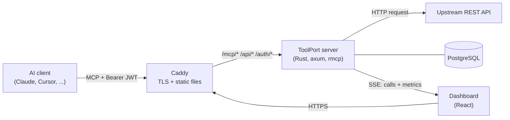

<p align="center">
  
</p>

<p align="center">
  <a href="https://github.com/ksrichard/toolport/actions/workflows/ci.yml"></a>
  
  
  
  
</p>

ToolPort turns REST APIs into MCP servers.
You import an OpenAPI spec, and ToolPort serves each API operation as an MCP tool.
AI clients such as Claude Code, Claude Desktop, Cursor, and Gemini CLI connect to one URL with a token.
A live dashboard shows each call as it happens.

```
https://<host>/mcp/<server-name>
```

## Features

- **OpenAPI import.** Import a spec from a URL or a file. ToolPort makes one tool per operation. Path, query, and body parameters become one input schema.
- **Tool builder.** Build a tool by hand, or edit an imported one. The preview shows the exact `tools/list` JSON. The Test button shows the MCP result and the raw HTTP exchange, with secrets masked.
- **Live dashboard.** Calls per minute, error rate, p50 and p95 latency, connected clients, and a paged call log. Server-Sent Events update the page as calls arrive.
- **Tokens.** Each MCP client gets its own JWT. The value shows once, at creation. A revoke works at once. A token lives 1 to 365 days, or forever.
- **Re-import and daily check.** A re-import keeps your edited tools and reports the added, kept, and removed tools. An optional daily check re-imports the spec when it changes.
- **Safe upstream calls.** The upstream client refuses private, loopback, and link-local addresses. This covers DNS answers, IP literals, and redirects. Upstream secrets are encrypted at rest with AES-256-GCM.
- **Rate limits.** Each token has a token bucket, and each account has one more bucket that all of its tokens share.
- **Plans and billing.** Free and Pro plans with server, tool, call, and history limits. Stripe Checkout and the Customer Portal handle payments.
- **Three themes.** Neon terminal (default), Calm dark, and Clean light. The dashboard saves the theme for each user.

## How it works



1. You sign in with GitHub and import an OpenAPI spec into a server.
2. You create a token and paste the client command into your AI client.
3. The client calls `tools/list` and `tools/call` on `/mcp/<server-name>`.
4. ToolPort checks the token, turns each tool call into an HTTP request to the upstream API, and returns the response.
5. ToolPort saves the call, and the dashboard shows it at once.

## Quick start

You need Docker with Compose, and a GitHub OAuth app.

1. Create a GitHub OAuth app at https://github.com/settings/developers.
   - Homepage URL: `https://localhost`
   - Callback URL: `https://localhost/auth/github/callback`
2. Create the env file:
   ```sh
   cp .env.example .env
   ```
   Set `POSTGRES_PASSWORD`, and put the same password in `DATABASE_URL`.
   Set `JWT_SECRET` and `SECRETS_KEY` to the output of `openssl rand -hex 32`.
   Set `GITHUB_CLIENT_ID` and `GITHUB_CLIENT_SECRET` from your OAuth app.
3. Start the whole system:
   ```sh
   docker compose up --build
   ```
4. Open https://localhost and sign in. Your browser warns about the local Caddy certificate the first time.

The onboarding wizard helps you create your first server.
You can start from a template (GitHub issues, Hacker News, Open-Meteo) or from your own spec.

## Connect a client

The dashboard shows the command for each client. For Claude Code, it looks like this:

```sh
claude mcp add --transport http my-server https://localhost/mcp/my-server \
  --header "Authorization: Bearer <token>"
```

## Local development

Run only Postgres in Docker, and run the backend and the frontend on the host:

```sh
docker compose up -d --wait postgres
set -a; . ./.env; set +a
cargo run -p server            # backend on :8080; add -- --help for the settings
cd web && npm install && npm run dev   # Vite on :5173
```

Vite sends `/api`, `/auth`, and `/mcp` to `localhost:8080`.
A GitHub OAuth app allows only one callback host.
For Vite, make a second OAuth app with the callback `http://localhost:5173/auth/github/callback`.

Checks (CI runs the same ones):

```sh
cargo fmt --all -- --check
cargo clippy --all-targets -- -D warnings
cargo test                     # needs Postgres and DATABASE_URL
cd web && npm run lint && npm run build && npm run check:preview
docker compose config
```

## Deploy

`.github/workflows/deploy.yml` deploys `main` to one VPS, for example at https://toolport.example.com.
The workflow is turned off in this repo. To use it in your fork, add the settings below and turn it on in the Actions tab.

1. A push to `main` runs CI.
2. When CI passes, the deploy workflow builds the `toolport-server` and `toolport-caddy` images and pushes them to GHCR.
3. The workflow copies `compose.yaml`, `compose.prod.yaml`, and a new `.env` to `/opt/toolport` on the VPS.
4. It pulls the new images, restarts the stack, and checks `/api/health`.

Caddy is the only service with public ports. It gets and renews the Let's Encrypt certificate by itself.
The database and the certificates live in host folders on the VPS: `/var/lib/toolport/postgres` and `/var/lib/toolport/caddy`.
No Docker command deletes them, also not `docker compose down -v` or `docker volume prune`.
When a folder is missing, the deploy stops. It never starts an empty database.
The DNS record must point straight to the VPS, without the Cloudflare proxy.

The workflow reads these settings from the repo:

| Name | Kind | Content |
| --- | --- | --- |
| `VPS_HOST`, `TOOLPORT_DOMAIN` | Variable | The VPS address and the public domain. |
| `VPS_SSH_KEY`, `VPS_KNOWN_HOSTS` | Secret | The deploy SSH key and the VPS host key. |
| `POSTGRES_PASSWORD`, `JWT_SECRET`, `SECRETS_KEY` | Secret | The production values. Never change `SECRETS_KEY`, because it decrypts the stored upstream secrets. |
| `OAUTH_GITHUB_CLIENT_ID`, `OAUTH_GITHUB_CLIENT_SECRET` | Secret | The production GitHub OAuth app. GitHub does not allow secret names that start with `GITHUB_`. |
| `STRIPE_SECRET_KEY`, `STRIPE_WEBHOOK_SECRET` | Secret | Optional. Without them, payments are off. |

To deploy by hand, open the Actions tab and run the "Deploy" workflow.

## Configuration

All settings come from env vars. Each backend setting is also a command-line flag.
`.env.example` lists every variable with a safe example value.

| Variable | Default | Purpose |
| --- | --- | --- |
| `TOOLPORT_DOMAIN` | `localhost` | The site address. A real domain gets a Let's Encrypt certificate. |
| `UPSTREAM_TIMEOUT_MS` | `10000` | The time limit for one upstream API call. |
| `RATE_LIMIT_PER_MINUTE` | `60` | Tool calls per minute for each token. `0` turns the limit off. |
| `USER_RATE_LIMIT_PER_MINUTE` | `300` | Tool calls per minute for all tokens of one user. `0` turns the limit off. |
| `SPEC_CHECK_INTERVAL_SECS` | `3600` | The time between two runs of the daily spec check. |
| `ALLOW_LOCAL_UPSTREAM` | `false` | Lets tools call APIs on loopback addresses. Use it only in local dev. |
| `STRIPE_SECRET_KEY`, `STRIPE_WEBHOOK_SECRET` | empty | Turn on payments. Without them, the billing routes return 503. |

For Stripe test mode, see the "Payments (test mode)" section in [`CLAUDE.md`](CLAUDE.md).

## Repository layout

| Path | Contents |
| --- | --- |
| `crates/core` | Domain types and the OpenAPI-to-tool conversion. No I/O. |
| `crates/server` | The axum app: dashboard REST API, MCP endpoint, SSE, and database. |
| `web/` | The React dashboard (Vite, TypeScript, plain CSS). |
| `migrations/` | sqlx migrations. The server runs them at startup. |
| `docker/` | The Dockerfiles and the Caddyfile. |
| `scripts/` | Stripe test-mode setup scripts. |
| `mockups/` | The design of the Live page. |

## Tech stack

Rust with `tokio`, `axum`, `rmcp`, `sqlx`, `reqwest` (rustls), `openapiv3`, `jsonwebtoken`, and `aes-gcm`.
React, Vite, and TypeScript on the frontend. `ts-rs` generates the TypeScript API types from Rust.
PostgreSQL 17, Caddy 2, and Docker Compose for the runtime.
